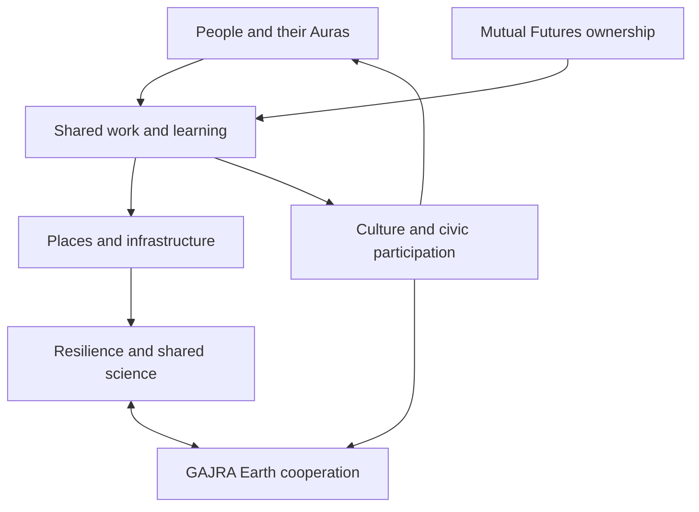

The whole system connects personal agency with shared productive capacity, public participation and the ability to continue through disruption. Joyful Responsible Abundance gives it a purpose. Mutual Futures is central to the ownership, livelihood and time arrangements through which that purpose enters daily life.

The invitation into it is CYOA, Choose Your Own Adventure, from the beginning. You keep doing your usual work. If you choose to explore the architecture, you gain a new stream of opportunities and systemic targets with grounded local starting points. The exploration is non-binding.

## Begin with a person living one life

A person experiences housing, income, health, learning, family responsibilities, public decisions and technology together. The proposal begins with that lived whole.

Aura of Intelligence is the proposed personal computing environment for organising relevant context and working with AI. Information about a person remains under their chosen permissions. The intended benefit is continuity: an evolving relationship with tools that understand the context the person has actually chosen to provide.

A community also has shared information and work. Public facilities, local businesses, ecosystems, cultural records and council decisions have their own responsibilities. Personal control and shared responsibilities meet through particular agreements and exchanges.

## Ownership and the gains from growing capability

Mutual Futures asks how ownership, learning, income, care and time develop as AI and automation change production. Business succession is one practical route. New enterprises, research and shared infrastructure provide others.

The intended transition includes experienced owners passing on knowledge, younger people gaining real capability, paid learning across different roles and members sharing in productive assets. It also makes room for people who are caring, studying, resting or unable to work.

C-Hours provide a separate record of voluntary human contribution. Financial accounts, employment arrangements and outcomes retain their own records. Recognising care and community work makes those contributions visible while preserving their reciprocal character.

## Shared work, places and computing

Ready S.E.T. Co-op is the proposed work, learning, equipment and shared-service layer. A Cultural Intelligence Node provides a concrete proposal for local computing and skills. Place-based projects provide settings for making, repair, food, culture, housing, care and community life.

The relationships between them matter. A makerspace needs skills, tools, maintenance and useful work. A media network needs people who understand stories, permissions and sources. A computing node needs power, cooling, operators and workloads. Each service becomes more useful when the surrounding relationships are developed with it.

## Public understanding and decisions

The screen and media network is intended to make information, stories, opportunities and disagreement visible in everyday settings. P4A, Purple Party for Australia, is currently a website and public civic workbench. Its objective is to seed and trigger a national Australian referendum on establishing a Cyber Republic on or before 2031. Its [dedicated chapter](https://github.com/auraofintelligence/Paul-overview-handover/wiki/P4A-law-and-democratic-participation) explains the present status and the constitutional ambition.

The creative work gives people different ways into difficult questions. A film, song or game might open a conversation that a formal report would never reach. Sources and serious discussion remain available behind the public introduction.

## Physical capability and continuity

Transport, energy, water, food, material processing, repair and communications support ordinary life and preparation for disruptions. Their design also affects ownership, employment, ecology and public space.

The longer habitat work explores underground settlements with the productive systems to support successive generations. The Solar Swarm and Sensorium explore observation, modelling and shared scientific inquiry. The same broad programme therefore connects everyday usefulness with severe-disruption scenarios and long-term possibilities.

## The relationships at a glance

The arrows show intended relationships. The actual people, resources, agreements and operating services are developed through each project.

## Cooperation across places

GAJRA Earth is the proposed Global Association for Joyful Responsible Abundance on Earth. Locally shaped associations would define what those words mean in their own lives, test practical work and share what they learn.

Australia's proposed role in the international programme is to help people and countries cooperate across differences. Shared scientific observation, resilience, learning and peaceful development provide possible common work. Each place keeps its own judgement and responsibilities.

## What joins the parts

The useful common practices are understandable records, source identity, clear permissions, human relationships and ways to correct mistakes. A project record would identify its purpose, people, resources, decisions and results. A personal record would carry its owner's choices. A public statement would carry its evidence and date.

This approach also shapes the handover. You would choose which inputs to explore alongside your existing work. If people later choose to develop a particular activity, its practical arrangements would follow that choice. My wider path includes travel through an evolving chaos oracle: algorithms alter priorities while preserving serendipity and my own choice of where to be. The [travel chapter](https://github.com/auraofintelligence/Paul-overview-handover/wiki/Travel-agency-and-the-chaos-oracle) explains the connection.

The chapters that follow examine the parts in enough depth to discuss real choices. The directory is there for further exploration, rather than asking every reader to open the entire project collection at once.

---

[Previous: The path from 2011 to now](https://github.com/auraofintelligence/Paul-overview-handover/wiki/The-path-from-2011-to-now) · [Home](https://github.com/auraofintelligence/Paul-overview-handover/wiki/Home) · [Next: Mutual Futures](https://github.com/auraofintelligence/Paul-overview-handover/wiki/Mutual-Futures)
