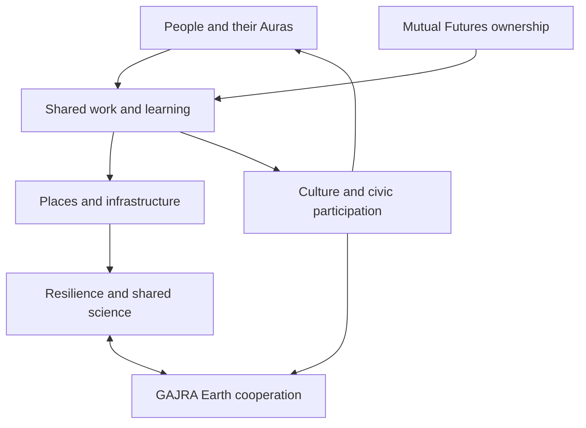

The whole system connects personal agency with shared productive capacity, public participation and the ability to continue through disruption. Joyful Responsible Abundance gives it a purpose. [Mutual Futures](https://auraofintelligence.github.io/mutual-futures/) is central to the ownership, livelihood and time arrangements through which that purpose enters daily life.

## Begin with a person living one life

[Aura of Intelligence](https://github.com/auraofintelligence/Paul-overview-handover/wiki/Aura-and-Genesis) is the proposed personal computing environment for organising relevant context and working with AI. Information about a person remains under their chosen permissions. The intended benefit is continuity: an evolving relationship with tools that understand the context the person has actually chosen to provide.

## Ownership and the gains from growing capability

[Mutual Futures](https://auraofintelligence.github.io/mutual-futures/) asks how ownership, learning, income, care and time develop as AI and automation change production. Business succession is one practical route. New enterprises, research and shared infrastructure provide others.

The intended transition includes experienced owners passing on knowledge, younger people gaining real capability, paid learning across different roles and members sharing in productive assets. It also makes room for people who are caring, studying, resting or unable to work.

[C-Hours](https://github.com/auraofintelligence/Paul-overview-handover/wiki/C-Hours-and-reciprocity) provide a separate record of voluntary human contribution. Financial accounts, employment arrangements and outcomes retain their own records. Recognising care and community work makes those contributions visible while preserving their reciprocal character.

## Shared work, places and computing

[Ready S.E.T. Co-op](https://github.com/auraofintelligence/ready-set-co-op-cultural-intelligence-node) is the proposed work, learning, equipment and shared-service layer. A Cultural Intelligence Node provides a concrete proposal for local computing and skills. Place-based projects provide settings for making, repair, food, culture, housing, care and community life.

## Public understanding and decisions

The [screen and media network](https://auraofintelligence.github.io/minjerribah-screen-media-network/) is intended to make information, stories, opportunities and disagreement visible in everyday settings. [P4A, Purple Party for Australia](https://p4a.xyz/), is currently a website and public civic workbench. Its objective is to seed and trigger a national Australian referendum on establishing a Cyber Republic on or before 2031. Its [dedicated chapter](https://github.com/auraofintelligence/Paul-overview-handover/wiki/P4A-law-and-democratic-participation) explains the present status and the constitutional ambition.

## Physical capability and continuity

Transport, energy, water, food, material processing, repair and communications support ordinary life and preparation for disruptions. Their design also affects ownership, employment, ecology and public space.

The longer habitat work explores underground settlements with the productive systems to support successive generations. The [Solar Swarm](https://auraofintelligence.github.io/virtual-solar-swarm/) and Sensorium explore observation, modelling and shared scientific inquiry. The same broad programme therefore connects everyday usefulness with severe-disruption scenarios and long-term possibilities.

## The relationships at a glance

## Cooperation across places

[GAJRA Earth](https://github.com/auraofintelligence/GAJRA-earth-infinity) is the proposed Global Association for Joyful Responsible Abundance on Earth. Locally shaped associations would define what those words mean in their own lives, test practical work and share what they learn.

Australia's proposed role in the international programme is to help people and countries cooperate across differences. Shared scientific observation, resilience, learning and peaceful development provide possible common work. Each place keeps its own judgement and responsibilities.

---

[Previous: The path from 2011 to now](https://github.com/auraofintelligence/Paul-overview-handover/wiki/The-path-from-2011-to-now) · [Home](https://github.com/auraofintelligence/Paul-overview-handover/wiki/Home) · [Next: Mutual Futures](https://github.com/auraofintelligence/Paul-overview-handover/wiki/Mutual-Futures)
